<div align="center">

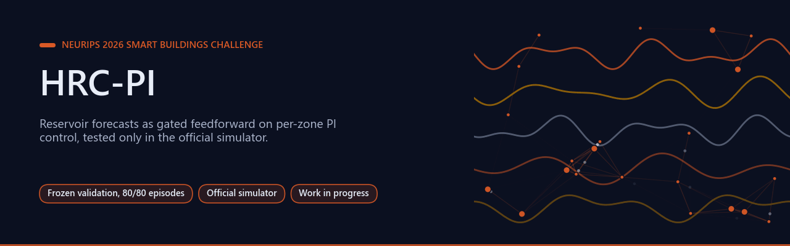

# HRC-PI: online reservoir forecasts for transferable HVAC control

[](https://github.com/Agnuxo1/hrc-hvac-neurips2026/actions/workflows/checks.yml) [](LICENSE)   [](results/validation-20261029) [](https://www.kaggle.com/competitions/neurips-2026-smart-buildings)

[**Results**](#measured-results-28-october) · [**Frozen validation**](#frozen-prospective-validation) · [**Reproduce**](#reproduce) · [**Protocol**](VALIDATION_PROTOCOL.json) · [**Validation data**](results/validation-20261029) · [**Analysis script**](experiments/analyse_validation.py) · [**Competition**](https://www.kaggle.com/competitions/neurips-2026-smart-buildings)

</div>

An entry under development for the [NeurIPS 2026 Smart Buildings Challenge](https://www.kaggle.com/competitions/neurips-2026-smart-buildings).
It combines the author's [Holographic Reservoir](https://github.com/Agnuxo1/Holographic-Reservoir)
with the credited public per-zone PI controller. The official simulator supplies
all temperatures, rewards and energy measurements. No synthetic reward model is used.

**Contents** — [Background](#background) · [What is implemented](#what-is-implemented) · [Measured results, 28 October](#measured-results-28-october) · [Frozen prospective validation](#frozen-prospective-validation) · [Reproduce](#reproduce) · [Real-world applications](#real-world-applications) · [Possible improvements](#possible-improvements) · [Future work](#future-work) · [Attribution and licence](#attribution-and-licence) · [Bibliography](#bibliography)

## Background

<p align="center">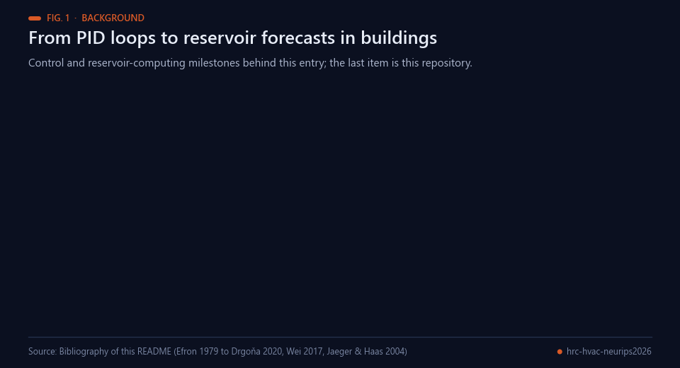<br><sub>Fig. 1 — Milestones behind this entry. Sources: bibliography below.</sub></p>

Heating, ventilation and air conditioning (HVAC) is a large part of what buildings consume: reviews of building
energy statistics report that buildings account for a substantial share of final energy use in developed countries
[[1](#ref-1)]. Feedback of the PID type remains the dominant control structure in industrial practice [[2](#ref-2)], and the
challenge's credited public controller is a per-zone PI loop. Such a loop reacts to an error that has already happened. Model predictive
control looks ahead over a forecast horizon, but needs a model of each building, and building-specific modelling is a
recurring practical barrier [[3](#ref-3)]; reinforcement learning has been applied to HVAC control as a model-free
alternative [[4](#ref-4)].

Reservoir computing offers a third route for the forecasting part. Echo-state networks [[5](#ref-5)] and liquid-state
machines [[7](#ref-7)] drive a fixed random recurrent network with the input and train only a linear readout; reviews
summarise the approach [[6](#ref-6)]. Because the readout is linear it can be updated online, which suits a forecaster that
must start from nothing inside each new building. This repository uses that idea in a deliberately small way: the
forecast does not replace the controller, it is added to the PI error through a gate.

The entry builds on public work. The reservoir code is derived from the author's public Holographic-Reservoir
repository [[8](#ref-8)]; the per-zone PI controller comes from a public Kaggle notebook by Malyshev Danil [[9](#ref-9)];
the simulator is the official starter kit [[10](#ref-10)] of the NeurIPS 2026 Smart Buildings Challenge [[11](#ref-11)]. The
validation compares paired scores with scenario-bootstrap intervals [[12](#ref-12), [13](#ref-13)].

## What is implemented

<p align="center">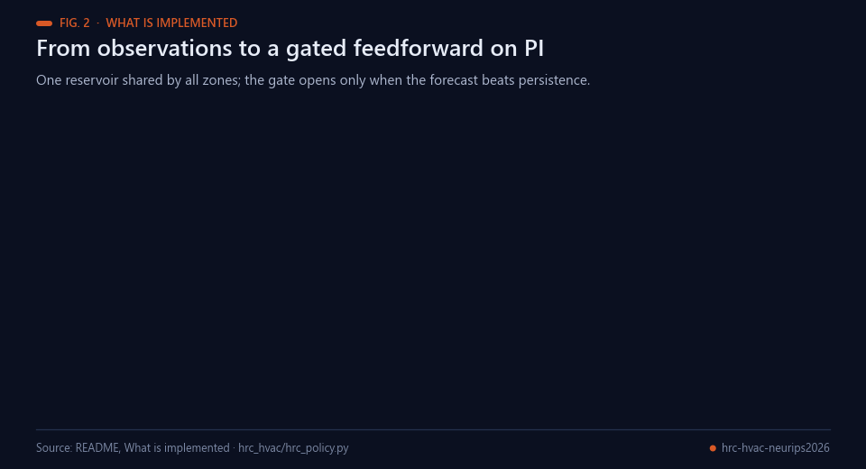<br><sub>Fig. 2 — The controller. Data: README and hrc_hvac/hrc_policy.py; the figure is a schematic.</sub></p>

The shared reservoir predicts each zone's temperature one hour ahead using only
observations available at that time. A gated feedforward term adjusts the PI error:
`error = temperature - target + kappa * gate * predicted_drift`.
The gate opens when the predictor beats persistence online; `kappa=0` exactly
recovers the PI control. Readout learning happens inside each new building;
validation scenarios never tune the offline settings.

## Measured results, 28 October

<p align="center">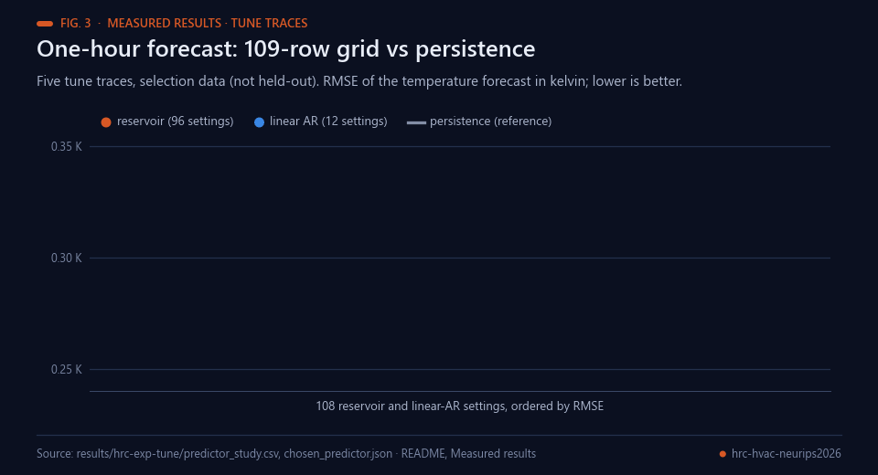<br><sub>Fig. 3 — One-hour forecast RMSE on the five tune traces (selection data). Data: results/hrc-exp-tune/predictor_study.csv.</sub></p>

**Three experimental stages use the real official simulator.**

| Stage | Measured outcome | Scope |
|---|---|---|
| One-hour prediction study | Selected reservoir RMSE 0.255631 K vs persistence 0.342138 K | Five tune traces; a 109-row predictor grid; selection data |
| Closed-loop feedforward sweep | HRC kappa0.25 score **0.0061340**, vs PI **0.0062008** (1.08% lower) | Five tune scenarios,4032steps each; not held-out or official score |
| Linear-readout ablation | AR kappa0.25 score **0.0061337**, slightly better than HRC on tune | Same scenarios and budget; reservoir benefit not established |

The frozen prospective validation is now complete: **80/80 episodes** across
16 scenarios (10 official and six generated building/weather combinations),
8640 steps each, with three reservoir seeds averaged inside each scenario.

<p align="center">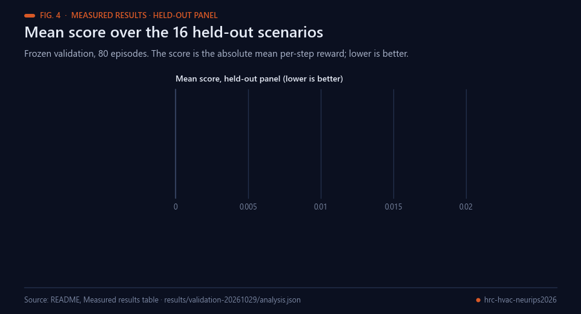<br><sub>Fig. 4 — Mean score on the held-out panel, lower is better. Data: README and analysis.json.</sub></p>

| Held-out panel, lower score is better | Mean score |
|---|---:|
| PI control | 0.0174040884 |
| HRC-PI, three-seed mean | **0.0173073431** |
| Linear AR control | 0.0172917679 |

HRC improves on PI by **0.56%**: paired mean difference −0.0000967453,
scenario-bootstrap 95% interval **[−0.0002038972, −0.0000083849]**;
11 scenarios improve and 5 regress. This passes the pre-registered PI
comparison gate. The two-sided sign test is 0.2101, so the evidence depends
on effect sizes rather than a significant win-count test.

<p align="center">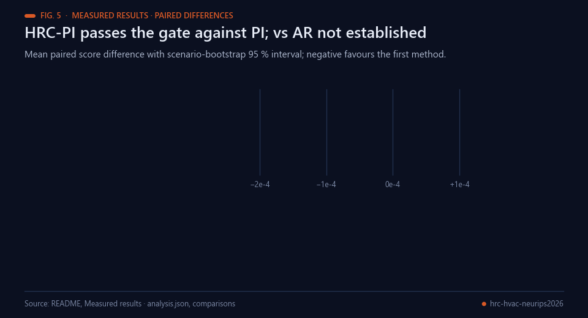<br><sub>Fig. 5 — HRC passes the gate against PI; reservoir-specific superiority over AR is not established. Data: results/validation-20261029/analysis.json.</sub></p>

HRC versus AR has mean difference +0.0000155752 and interval
[−0.0000376547, +0.0000882530]. **Reservoir-specific superiority over AR is
not established.** AR versus PI also has an interval crossing zero. These
comparisons do not invalidate the measured HRC-versus-PI improvement or
the earlier forecasting result. [All raw episodes and fixed analysis](results/validation-20261029).

The predictor improvement and small tune control gain are positive measured
results; the AR comparison and the finite scenario panel limit the conclusions.
They do not invalidate the forecasting gain or establish a leaderboard gain.

## Frozen prospective validation

<p align="center">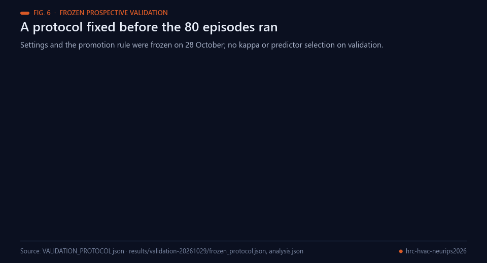<br><sub>Fig. 6 — The frozen protocol. Data: VALIDATION_PROTOCOL.json and results/validation-20261029/.</sub></p>

[`VALIDATION_PROTOCOL.json`](VALIDATION_PROTOCOL.json) fixes kappa0.25,
delta0.1,lambda0.99999,N150 and reservoir seeds0,1,2 before validation.
Compare all three seeds, the linear AR ablation and PI on the same16scenarios.
Average seeds within each scenario, then report paired score differences,
scenario-bootstrap intervals and sign tests. HRC is promoted only if it beats
PI with an upper95%interval below zero. Reservoir attribution also needs a
paired advantage over AR. Failed scenarios remain in the record.

The [analysis command](experiments/analyse_validation.py) is fixed while the
managed 80-episode run was in progress. It rejects missing, duplicate, failed,
nonfinite or short episodes; it never promotes from a partial panel. Every raw
row and each seed's result are retained. Run it after downloading the job:

```sh
python experiments/analyse_validation.py --csv output/validation.csv --out output/analysis.json
```

<p align="center">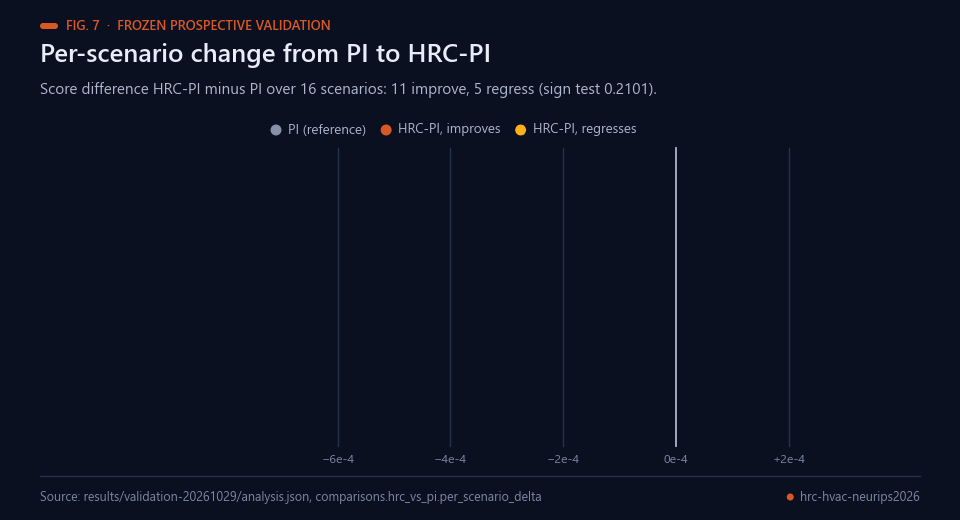<br><sub>Fig. 7 — Per-scenario paired differences, HRC-PI minus PI. Data: results/validation-20261029/analysis.json.</sub></p>

The bootstrap unit is a scenario after averaging reservoir seeds. Scenarios
can share buildings or weather, so the interval describes this fixed panel;
it does not establish performance on hidden competition cases. Intervals are
not adjusted for multiple comparisons. Reservoir attribution uses the same
negative-upper-interval rule against AR as promotion uses against PI.

The score is the absolute mean per-step reward; **lower is better**. A one-hour
forecast gain is not a controller or competition score. No final submission,
official score or paper acceptance is claimed for this repository.

## Reproduce

<p align="center">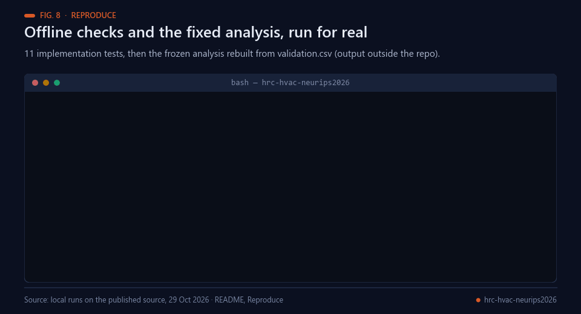<br><sub>Fig. 8 — Real local runs: the offline test suite and the frozen analysis rebuilt from validation.csv.</sub></p>

Install the [official starter kit](https://github.com/smart-buildings-2026/starter-kit)
and this project's `requirements.txt`. Use `experiments/run_eval.py --help` for
explicit kit,scenario,policy,step and worker arguments. `run_validation.py` is
the managed server job: it copies the official package into an isolated working
directory, generates the declared unseen scenarios and runs the fixed protocol.
It does not modify the shared kit. CPU work uses the server's managed queue,
four processes with one numerical-library thread each. No local GPU is used.

The official Kaggle API currently gives final deadline **15 January2027,
17:59:59UTC (18:59:59Madrid)**; earlier paper/entry deadlines must be checked
separately. Results here are simulator measurements and work in progress.

## Real-world applications

<p align="center">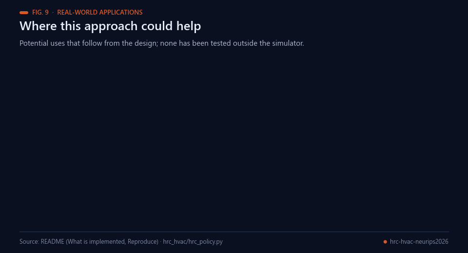<br><sub>Fig. 9 — Where this approach could help. All results so far are simulator measurements.</sub></p>

All results here come from the official simulator, so the following are potential uses that follow from the design,
not deployments:

- **Add-on to existing PI loops.** The feedforward term is added to a PI loop that is already in place; with
  `kappa=0` the original controller is recovered exactly, so the change can be switched off.
- **Acting before comfort slips.** A one-hour temperature forecast lets a controller respond to drift before the
  error appears.
- **Per-building learning.** The readout is learned online inside each new building, which avoids building-specific
  offline training data.
- **Guarded forecasts.** The gate keeps the forecast out of the loop whenever it does not beat persistence, a
  conservative behaviour for control software.
- **Energy and comfort studies.** The simulator reports comfort regret, energy cost and carbon, which suits
  controlled comparisons of building controllers.
- **A forecaster test bench.** Reservoir, linear AR and persistence predictors plug into the same policy, so the
  contribution of a forecaster can be tested in isolation.

## Possible improvements

<p align="center">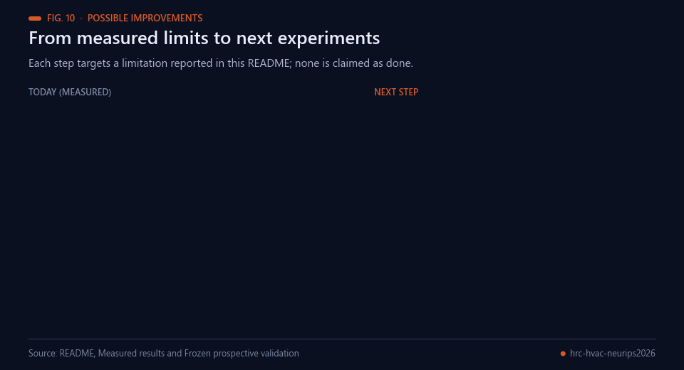<br><sub>Fig. 10 — Each improvement targets a limitation stated in this README.</sub></p>

- **The AR comparison.** HRC versus AR has an interval that crosses zero, so reservoir-specific superiority is not
  established. A stronger or differently regularised linear baseline, and richer inputs for the reservoir, should be
  tested under the same frozen gate before any attribution is claimed.
- **A finite scenario panel.** The 16 scenarios can share buildings or weather. A new frozen protocol with
  independent buildings and weather years would give a cleaner estimate, with failed scenarios kept in the record.
- **No hidden-case evidence.** The validation inputs are our generated scenarios, not hidden competition cases, and no
  leaderboard gain is claimed. Evaluation on hidden cases has to wait for the official data.
- **Multiple comparisons.** Intervals are not adjusted for multiple comparisons and the sign test (0.2101) is not
  significant. Declaring one primary contrast before the next run, and treating the others as secondary, would make
  the evidence easier to read.

## Future work

<p align="center">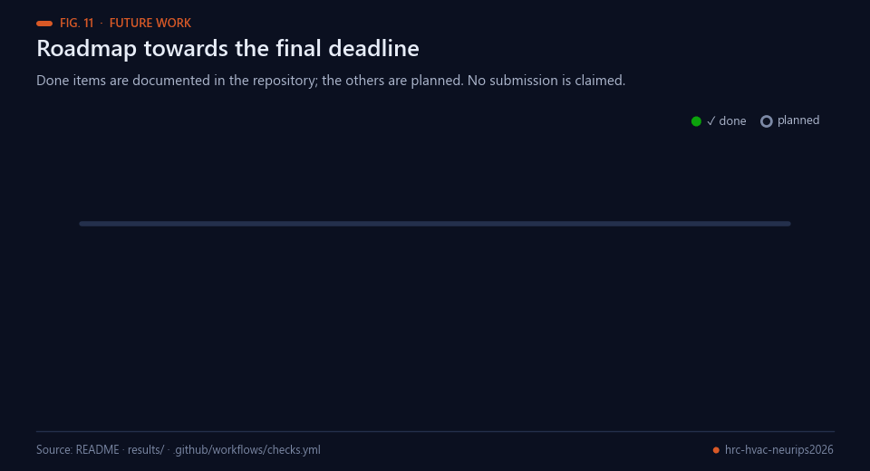<br><sub>Fig. 11 — Completed milestones are documented in this repository; the rest are planned.</sub></p>

Planned next steps, in order; none is claimed as started. The official Kaggle API currently gives a final deadline
of 15 January 2027, 17:59:59 UTC (18:59:59 Madrid); earlier paper or entry deadlines must be checked separately.
No final submission, official score or paper acceptance is claimed.

1. Re-test reservoir attribution against a stronger linear AR baseline under the same frozen gate.
2. Define a new frozen protocol with independent buildings and weather, and one declared primary contrast.
3. Evaluate on hidden competition cases when they are available.
4. Decide on a final entry before the 15 January 2027 deadline, and check the earlier paper or entry deadlines.

## Attribution and licence

Apache-2.0. See [NOTICE](NOTICE) for the author's Holographic-Reservoir,
Malyshev Danil's public ZT Best controller and the official starter kit.
Competition data and the starter kit are not redistributed. The scenario
definitions are our generated validation inputs, not hidden competition cases.

## Bibliography

1. <a id="ref-1"></a>Pérez-Lombard, L., Ortiz, J., & Pout, C. (2008). A review on buildings energy consumption information. *Energy and Buildings*, 40(3), 394–398. https://doi.org/10.1016/j.enbuild.2007.03.007
2. <a id="ref-2"></a>Åström, K.J., & Hägglund, T. (2001). The future of PID control. *Control Engineering Practice*, 9(11), 1163–1175. https://doi.org/10.1016/S0967-0661(01)00062-4
3. <a id="ref-3"></a>Drgoňa, J., Arroyo, J., Cupeiro Figueroa, I., et al. (2020). All you need to know about model predictive control for buildings. *Annual Reviews in Control*, 50, 190–232. https://doi.org/10.1016/j.arcontrol.2020.09.001
4. <a id="ref-4"></a>Wei, T., Wang, Y., & Zhu, Q. (2017). Deep Reinforcement Learning for Building HVAC Control. *Proceedings of the 54th Annual Design Automation Conference 2017*, 1–6. https://doi.org/10.1145/3061639.3062224
5. <a id="ref-5"></a>Jaeger, H., & Haas, H. (2004). Harnessing Nonlinearity: Predicting Chaotic Systems and Saving Energy in Wireless Communication. *Science*, 304(5667), 78–80. https://doi.org/10.1126/science.1091277
6. <a id="ref-6"></a>Lukoševičius, M., & Jaeger, H. (2009). Reservoir computing approaches to recurrent neural network training. *Computer Science Review*, 3(3), 127–149. https://doi.org/10.1016/j.cosrev.2009.03.005
7. <a id="ref-7"></a>Maass, W., Natschläger, T., & Markram, H. (2002). Real-Time Computing Without Stable States: A New Framework for Neural Computation Based on Perturbations. *Neural Computation*, 14(11), 2531–2560. https://doi.org/10.1162/089976602760407955
8. <a id="ref-8"></a>Angulo de Lafuente, F. *Holographic-Reservoir* (software, Apache-2.0). https://github.com/Agnuxo1/Holographic-Reservoir
9. <a id="ref-9"></a>Malyshev, D. *Smart Buildings Probe ZT Best* (public Kaggle notebook, Apache-2.0). https://www.kaggle.com/code/malyshevdanil/smart-buildings-probe-zt-best
10. <a id="ref-10"></a>Smart Buildings Competition organisers. *starter-kit: official simulator and starter kit for the NeurIPS 2026 Smart Buildings Challenge* (software, Apache-2.0). https://github.com/smart-buildings-2026/starter-kit
11. <a id="ref-11"></a>Kaggle. *Smart Buildings Competition* (NeurIPS 2026 Smart Buildings Challenge). https://www.kaggle.com/competitions/neurips-2026-smart-buildings
12. <a id="ref-12"></a>Efron, B. (1979). Bootstrap Methods: Another Look at the Jackknife. *The Annals of Statistics*, 7(1), 1–26. https://doi.org/10.1214/aos/1176344552
13. <a id="ref-13"></a>Efron, B., & Tibshirani, R. J. (1994). *An Introduction to the Bootstrap*. Chapman and Hall/CRC. https://doi.org/10.1201/9780429246593

---

<div align="center">
<sub>Built by <a href="https://github.com/Agnuxo1">Francisco Angulo de Lafuente</a> · every figure is an animated
rendering of the published file named in its footer · <a href="#hrc-pi-online-reservoir-forecasts-for-transferable-hvac-control">back to top ↑</a></sub>
</div>
